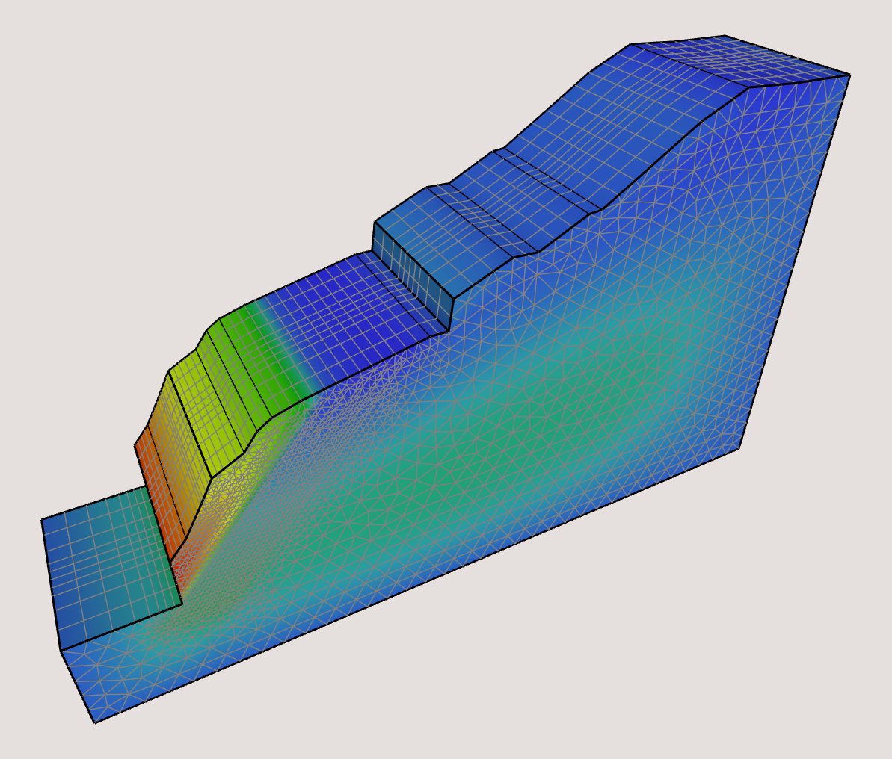

# MeshEditor 3.0 – User Guide

MeshEditor is a graphical editor of 3D finite element meshes. It is used to prepare input data for the finite element method (the preprocessor) and to visualize the results of a finite element analysis (the postprocessor).

- The **preprocessor** loads a mesh that was generated by a mesh generator, displays it, lets you select groups of nodes, elements, faces, edges and beams, and assign property numbers to them. Property numbers identify boundary conditions, loads, materials and other attributes that the solver assigns to the mesh entities. The mesh can be cut, parts of it can be hidden, and the modified mesh is saved for further processing (by default in the SIFEL file format).
- The **postprocessor** imports the results of an analysis (scalar, vector and tensor fields on the nodes of the mesh, for any number of time steps) into a *solution*, shows them as color maps and vector arrows, and creates derived layers: a deformed mesh, a slice and an iso-surface.

This guide describes the desktop application MeshEditor 3.0 for Windows and Linux.

## Contents

1. [Installation and start](#1-installation-and-start)
2. [User interface](#2-user-interface)
3. [Viewing the mesh](#3-viewing-the-mesh)
4. [Selecting mesh entities](#4-selecting-mesh-entities)
5. [Properties](#5-properties)
6. [Cutting the mesh and selecting in the volume](#6-cutting-the-mesh-and-selecting-in-the-volume)
7. [Showing and hiding elements](#7-showing-and-hiding-elements)
8. [Mesh information and edge angle limits](#8-mesh-information-and-edge-angle-limits)
9. [Other tools](#9-other-tools)
10. [Postprocessor](#10-postprocessor)
11. [Settings](#11-settings)
12. [Keyboard and mouse reference](#12-keyboard-and-mouse-reference)
13. [File formats](#13-file-formats)

---

## 1. Installation and start

MeshEditor needs no .NET installation: the packages contain everything the application needs. The graphics card has to support OpenGL (version 2.0 or newer is recommended).

**Windows** (10 or 11, 64-bit): unzip `MeshEditor-3.0.0-win-x64.zip` to any folder and start `MeshEditor.exe`.

**Linux** (Ubuntu 22.04 or newer, current Debian): install the package with apt, which also installs the libraries that MeshEditor needs:

```
sudo apt install ./mesheditor_3.0.0_amd64.deb
```

Don't use `dpkg -i`, it doesn't install the dependencies. The package also replaces an installed MeshEditor 2.x. MeshEditor runs on X11; Wayland desktops run it through XWayland, which Ubuntu has by default. When a library is missing or the OpenGL driver doesn't work, MeshEditor says so at startup.

**Starting MeshEditor.** A file name can be given on the command line; MeshEditor then opens it at startup:

```
MeshEditor.exe beam.top              (Windows)
mesheditor beam.top                  (Linux)
```

A solution file (`*.solution.json`) given this way opens in the postprocessor. Without a file name, MeshEditor opens the mesh that was open when it was closed the last time.

**Settings** are stored in `%APPDATA%\MeshEditor` on Windows and in `~/.config/MeshEditor` on Linux. The settings of MeshEditor 2.x are kept, and solutions created by MeshEditor 2.x open in 3.0.

**Updates.** At startup MeshEditor checks in the background whether a newer version is available, and offers to download it. You can check it any time with *Help → Check for updates*.

---

## 2. User interface

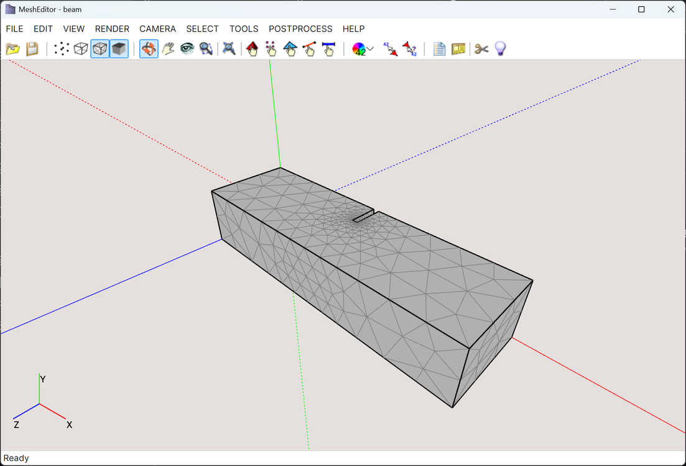

The main window consists of:

- the **main menu** (FILE, EDIT, VIEW, RENDER, CAMERA, SELECT, TOOLS, POSTPROCESS, HELP),
- the **tool bar** with the most frequently used commands,
- the **viewport** that displays the mesh. The viewport can be split into several views (see [Splitting the viewport](#36-splitting-the-viewport)),
- the **status bar**, which shows information about the selected entities, the point under the mouse cursor and the progress of long operations.

The title bar shows the name of the mesh in the active view. In the postprocessor, the main window also has a left panel with the solution layers and the data selection (see [Postprocessor](#10-postprocessor)).

### 2.1 Editor modes

Some commands of the CAMERA and SELECT menus set the **editor mode**. The mode determines what happens when you click or drag with the left mouse button in the viewport: rotate the camera, move it, zoom, or select entities of a particular type. The current mode is highlighted in the tool bar, and the mouse cursor changes with it. The mode is the same for all views.

### 2.2 Tool bar

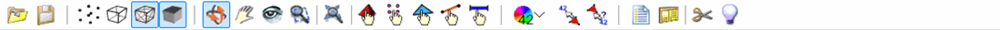

From left to right, the tool bar buttons are:

| Group | Buttons |
|---|---|
| File | Open (Ctrl+O), Save As (Ctrl+S) |
| Rendering | Show points, Show border lines, Show all lines, Show faces – the four parts of the mesh drawing can be switched on and off independently (border lines and all lines exclude each other) |
| Camera tools | Orbit (O), Pan (P), Look around (L), Zoom window (Z) |
| | Zoom to fit |
| Selection tools | Select elements (E), nodes (N), faces (F), edges (G), beams (B) |
| Properties | Property colors (drop-down menu with the entity types and *Configure property colors*), Set property of selected entities (Enter), Select entities by property (F6) |
| Information | List of selected entities (F3), Mesh info (F4) |
| Tools | Cut / Select area (F8), Show / hide elements (F9) |

### 2.3 Main menu

#### FILE

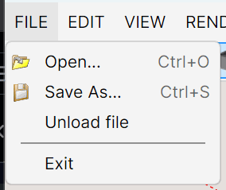

- **Open...** (Ctrl+O) – opens a mesh file in the active view. You can select several files at once; they are loaded into a single mesh. If you open a solution file (`*.solution.json`), MeshEditor switches to the postprocessor. If the current mesh has unsaved changes, MeshEditor asks whether to save them first.
- **Save As...** (Ctrl+S) – saves the mesh of the active view. The file format is chosen by the file extension (SIFEL, GiD mesh or VTK, see [File formats](#13-file-formats)). If some elements are hidden (cut off or hidden by the Show / Hide elements tool), MeshEditor asks whether to save only the visible part of the mesh (*Yes*) or the whole original mesh (*No*).
- **Unload file** – closes the mesh of the active view (and asks to save unsaved changes).
- **Exit** – closes MeshEditor. Before that, MeshEditor asks to save all meshes with unsaved changes.

#### EDIT

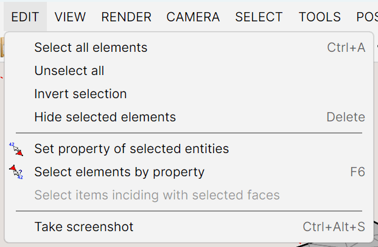

The names of some items change with the editor mode; for example *Select all elements* becomes *Select all faces* when the face selection tool is active.

- **Select all ...** (Ctrl+A) – selects all entities of the type given by the current selection tool.
- **Unselect all** – clears the selection.
- **Invert selection** – selects all entities that are not selected (only entities of the same type as the selected ones are considered).
- **Hide selected elements** (Delete) – hides the selected elements. It works like a cut, but the hidden elements are given by the selection instead of their position. *Tools → Restore mesh* shows them again.
- **Set property of selected entities** (Enter) – assigns a property number to the selected entities (see [Properties](#5-properties)).
- **Select ... by property** (F6) – selects all entities with a given property. The type of the entities depends on the current selection tool. Shift+F6 opens the same dialog with *add to selection* checked.
- **Select ... inciding with selected faces** – selects all entities (elements, edges or nodes, according to the current selection tool) that belong to the selected faces. For example, with the edge selection tool it selects all edges of the selected faces.
- **Take screenshot** (Ctrl+Alt+S) – saves an image of the active view (see [Screenshots](#93-screenshots)).

#### VIEW

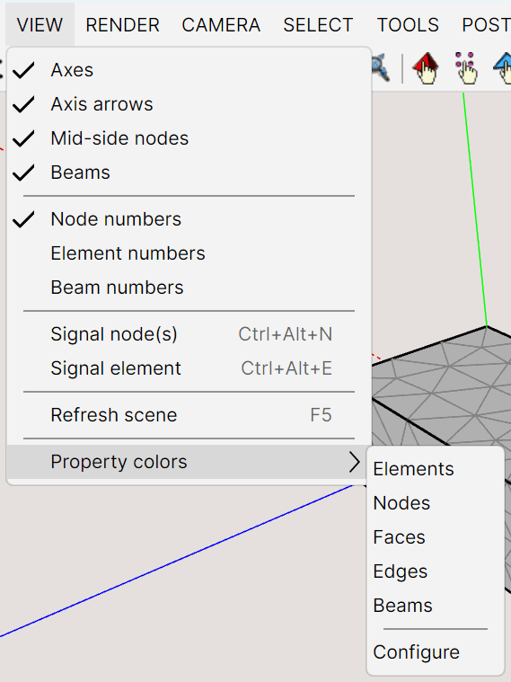

- **Axes** – shows or hides the coordinate axes. The positive half-axes are drawn as solid lines, the negative ones as dashed lines.
- **Axis arrows** – shows or hides the small coordinate system in the bottom left corner of the view.
- **Mid-side nodes** – shows or hides the nodes in the middle of edges of elements with quadratic approximation (only when nodes are displayed).
- **Beams** – shows or hides the 1D (beam) elements.
- **Node numbers**, **Element numbers**, **Beam numbers** – show the numbers (IDs) of the entities. The numbers are displayed only when the corresponding entities are displayed (for example nodes in the *Points* render mode) and only when they are not too dense on the screen. If some numbers are missing, zoom in.
- **Signal node(s)** (Ctrl+Alt+N), **Signal element** (Ctrl+Alt+E) – highlight a node or an element given by its ID (see [Signaling nodes and elements](#92-signaling-nodes-and-elements)). Choosing the checked item again removes the highlight.
- **Refresh scene** (F5) – redraws the whole scene.
- **Property colors** – colors the entities by their property numbers. The colors can be switched on for each entity type separately and combined (except element and face colors, which exclude each other). *Configure* changes the colors (see [Property colors](#54-property-colors)).

#### RENDER

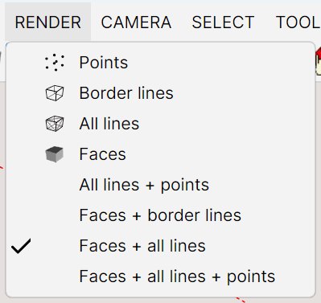

Sets the render mode of the active view: **Points** (nodes on the surface of the mesh), **Border lines** (sharp edges only), **All lines** (all surface edges, a wireframe), **Faces** (the surface of the mesh), and their combinations. The same can be set with the four rendering buttons of the tool bar. The *M* key cycles through the render modes.

#### CAMERA

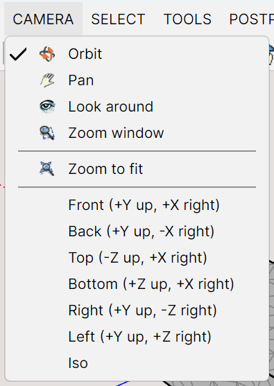

- **Orbit**, **Pan**, **Look around**, **Zoom window** – the camera tools (see [Camera manipulation](#32-camera-manipulation)).
- **Zoom to fit** – moves the camera so that the whole mesh fits in the view.
- **Front, Back, Top, Bottom, Right, Left, Iso** – set the camera to one of the standard views. The names show which axes point up and to the right.

#### SELECT

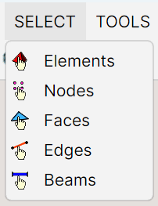

Selects the selection tool: **Elements**, **Nodes**, **Faces**, **Edges** or **Beams** (see [Selecting mesh entities](#4-selecting-mesh-entities)).

#### TOOLS

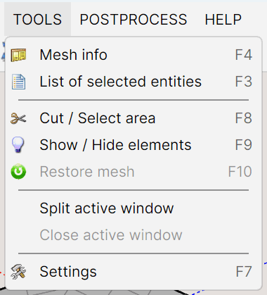

- **Mesh info** (F4) – information about the mesh, property descriptions and edge angle limits (see [Mesh information](#8-mesh-information-and-edge-angle-limits)).
- **List of selected entities** (F3) – a list of the selected entities (see [List of selected entities](#44-list-of-selected-entities)).
- **Cut / Select area** (F8) – the cutting area editor (see [Cutting the mesh](#6-cutting-the-mesh-and-selecting-in-the-volume)).
- **Show / Hide elements** (F9) – shows only elements with given properties or types (see [Showing and hiding elements](#7-showing-and-hiding-elements)).
- **Restore mesh** (F10) – shows all hidden and cut-off elements again.
- **Split active window**, **Close active window** – see [Splitting the viewport](#36-splitting-the-viewport).
- **Settings** (F7) – the application settings (see [Settings](#11-settings)).

#### POSTPROCESS

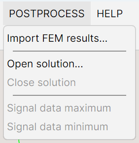

- **Import FEM results...** – imports a mesh and analysis results into a new solution and opens it.
- **Open solution...** – opens an existing solution.
- **Close solution** – closes the solution and returns to the preprocessor.
- **Signal data maximum**, **Signal data minimum** – highlight the nodes with the maximum or minimum value of the displayed scalar field.

See [Postprocessor](#10-postprocessor) for details.

#### HELP

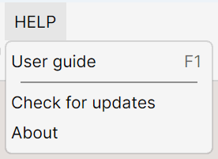

- **User guide** (F1) – opens this guide.
- **Check for updates** – checks whether a newer version of MeshEditor is available.
- **About** – the version of MeshEditor and its authors.

### 2.4 Context menu of the viewport

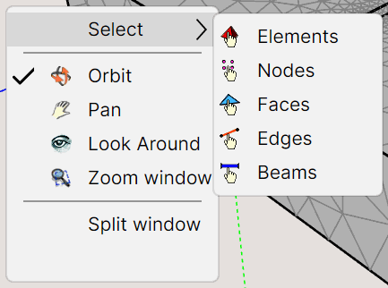

The right mouse button in the viewport opens a context menu with the selection tools (*Select*), the camera tools, **Split window** and **Close window** (only when the viewport is split).

### 2.5 Status bar

The status bar describes the current selection. When more entities are selected, it shows their count (for example *76 faces*); when one entity is selected, it shows its type, number, properties and, for a node, its position:


When you press and hold the left mouse button on the mesh (without moving the mouse), the status bar shows the coordinates of the point under the cursor in the coordinate system of the mesh. During long operations, the status bar shows their progress in blue. If an operation takes longer than half a second, a progress window with a *Cancel* button appears.

---

## 3. Viewing the mesh

### 3.1 Render modes

The render mode determines which parts of the mesh are drawn. Use the RENDER menu, the rendering buttons of the tool bar, or the *M* key.

| Points | Border lines |
|---|---|
| 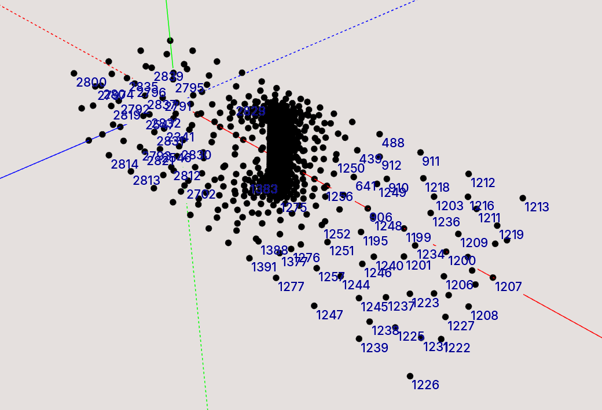 | 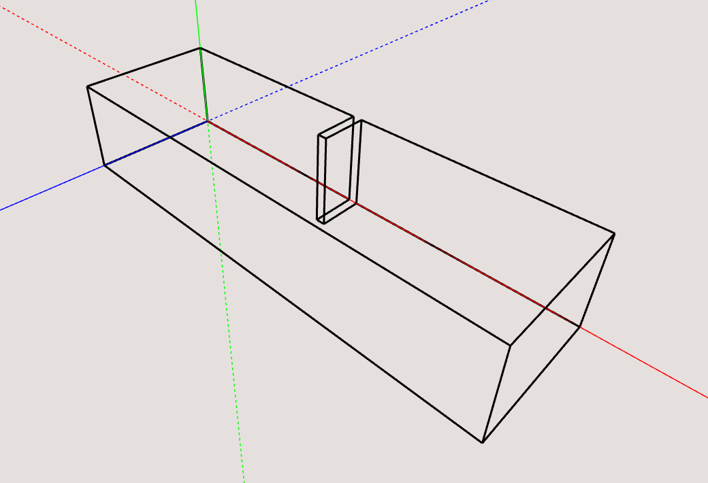 |
| **All lines** | **Faces + border lines** |
| 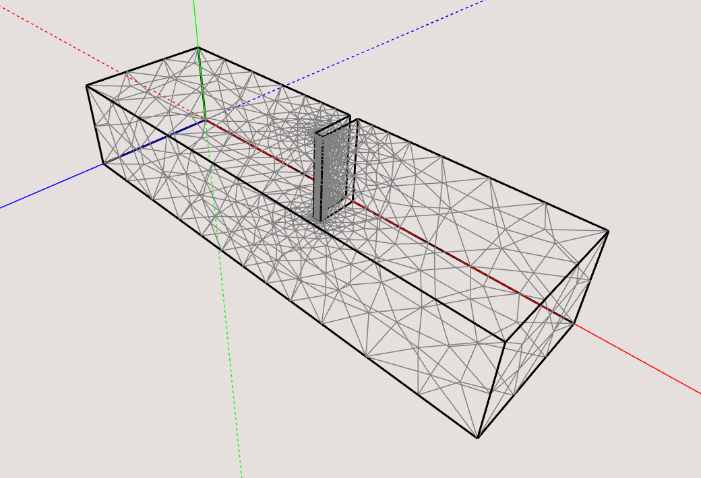 | 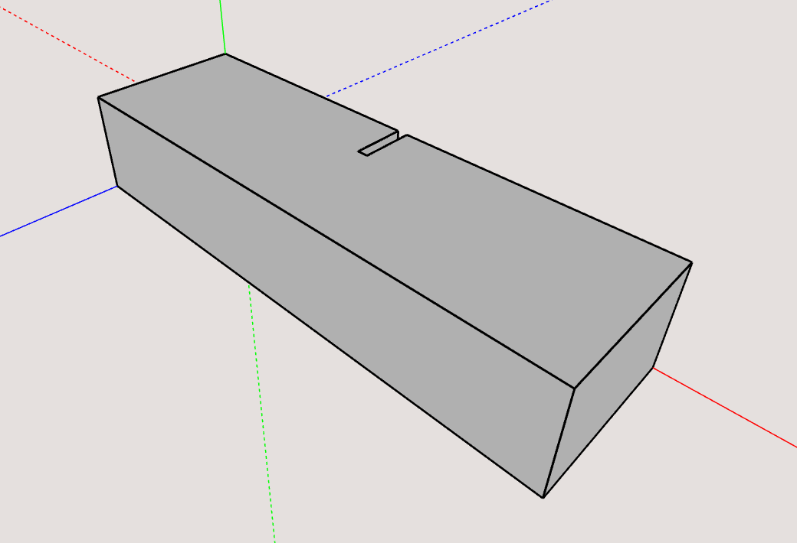 |

*Border lines* are the sharp edges of the mesh surface, at which the adjacent faces form an angle greater than the first edge angle limit (see [Edge angle limits](#82-edge-angle-limits)). They are drawn thicker and darker than the ordinary edges.

When you choose a selection tool, MeshEditor switches on the part of the drawing that the tool needs: faces for the element and face selection, points for the node selection and all lines for the edge selection.

The lighting of the faces depends on their normal vectors. The appearance of all entities (colors, line widths, node size, lighting, smoothing) can be changed in [Settings](#11-settings). The keys *7*, *8*, *9* and *0* quickly switch face lighting, line smoothing, point smoothing and edge lighting on and off.

### 3.2 Camera manipulation

The camera tools are in the CAMERA menu, in the tool bar, in the context menu of the viewport, and they have keyboard shortcuts.

- **Orbit** (O) rotates the mesh. If you press the left mouse button on the surface of the mesh, the mesh rotates around the point under the cursor. If you press it outside the mesh, the mesh rotates around its center.
- **Pan** (P) moves the mesh up, down, left and right. The point where you pressed the mouse button stays under the cursor during the whole movement.
- **Look around** (L) turns the camera without moving it, as if you turned your head. It is useful when the camera is inside a cavity of the mesh and you want to look at the surrounding surface.
- **Zoom window** (Z) zooms in. Drag a rectangle around the region you want to see, or click on the point you want to zoom in to.
- **Zoom to fit** (or a click with the middle mouse button) moves the camera so that the whole mesh fills the view.

**Mouse wheel** zooms in and out towards the point under the cursor, regardless of the editor mode. The zoom speed depends on the distance from the surface; the camera can also go through the surface into the mesh.

**Modifier keys.** While a camera tool is active, holding *Shift* or *Ctrl* switches temporarily to another tool, so you rarely need to change the tool:

| Active tool | Shift held | Ctrl held |
|---|---|---|
| Orbit | Pan | Look around |
| Pan | Orbit | Look around |
| Look around | Pan | Orbit |

The **arrow keys** move the camera forward (Up), back (Down), left and right in small steps; the *R* key resets the camera to the default view. The CAMERA menu sets the standard views (front, back, top, bottom, right, left and isometric).

### 3.3 Numbers of nodes and elements

*VIEW → Node numbers*, *Element numbers* and *Beam numbers* show the IDs of the entities. The numbers are drawn only for the entities that are displayed, and only where they don't overlap too much; zoom in to see the numbers in a dense part of the mesh.

### 3.4 Axes

*VIEW → Axes* shows the coordinate axes through the origin of the mesh coordinate system (X red, Y green, Z blue; the negative parts are dashed). *VIEW → Axis arrows* shows the small coordinate system in the bottom left corner, which indicates the orientation of the view.

### 3.5 Active view and background

The view that receives the commands is the *active* view. Click into a view to activate it. The active and the inactive views have different background colors (see [Settings](#11-settings)).

### 3.6 Splitting the viewport

One mesh can be displayed in several views at the same time, each with its own camera and render mode. *Tools → Split active window* (or *Split window* in the context menu) splits the active view into two halves. Both views share the same mesh, so a change of the mesh (selection, properties, cut) is visible in both of them.

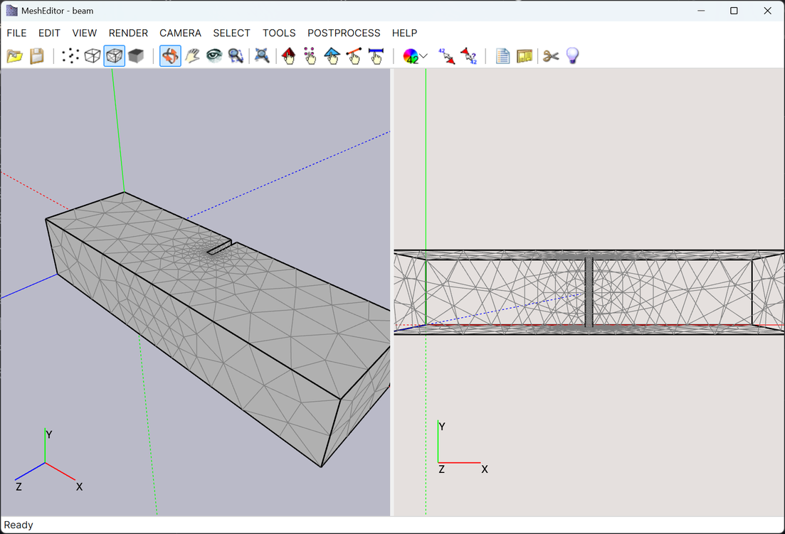

A new view can also load a different mesh with *File → Open*. A view is closed with *Tools → Close active window*, with *Close window* in the context menu, or by dragging the splitter to the edge of the window.

---

## 4. Selecting mesh entities

There are five selection tools, one for each type of entity: **elements** (E), **nodes** (N), **faces** (F), **edges** (G) and **beams** (B, the 1D elements). Faces and edges are the faces and edges on the surface of the mesh. For meshes of 2D elements (triangles and quadrilaterals), the elements are identical to their faces, so the element and the face selection work the same.

The selected entities are highlighted with the selection colors (see [Settings](#11-settings)), and the status bar describes them.

### 4.1 Selecting by clicking

A click selects the entity under the cursor. Repeated clicks at the same place select larger connected regions of the surface. The region grows over the edges of the mesh until it reaches an edge whose angle exceeds an edge angle limit (see [Edge angle limits](#82-edge-angle-limits)):

| Clicks | Selected entities |
|---|---|
| 1 | the single entity under the cursor |
| 2 | the entities of the adjacent surface up to the edges exceeding the **first** edge angle limit |
| 3 | the entities of the adjacent surface up to the edges exceeding the **second** edge angle limit |
| 4 | the entities of the whole connected surface (not limited by any edges) |

| One click | Double click | Four clicks |
|---|---|---|
| 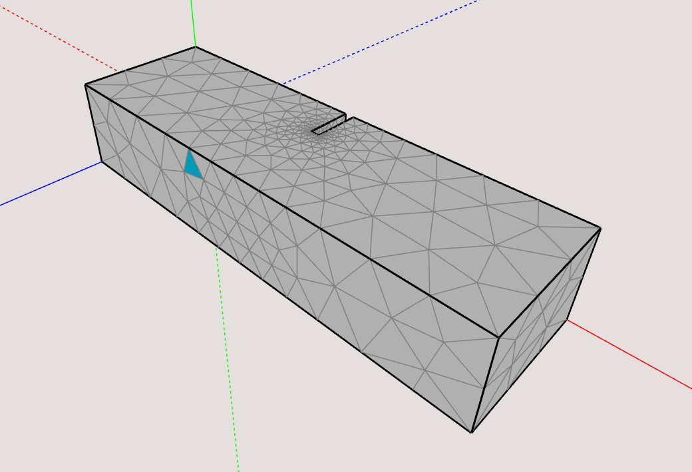 | 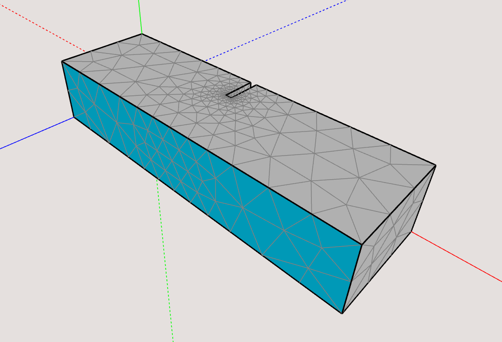 | 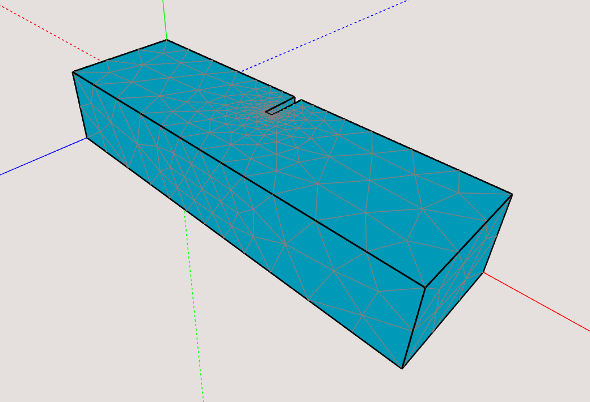 |

The edge and node selection tools behave a little differently when you click on a sharp edge: repeated clicks then select a curve composed of sharp edges (or its nodes) instead of a surface. The limits of the curve change with the number of clicks in the same way.

### 4.2 Selecting by a rectangle

Drag a rectangle with the left mouse button to select all entities in it. The direction of the dragging matters:

- **from left to right**, only the entities whose nodes all lie in the rectangle are selected,
- **from right to left**, it is enough that one node of the entity lies in the rectangle.

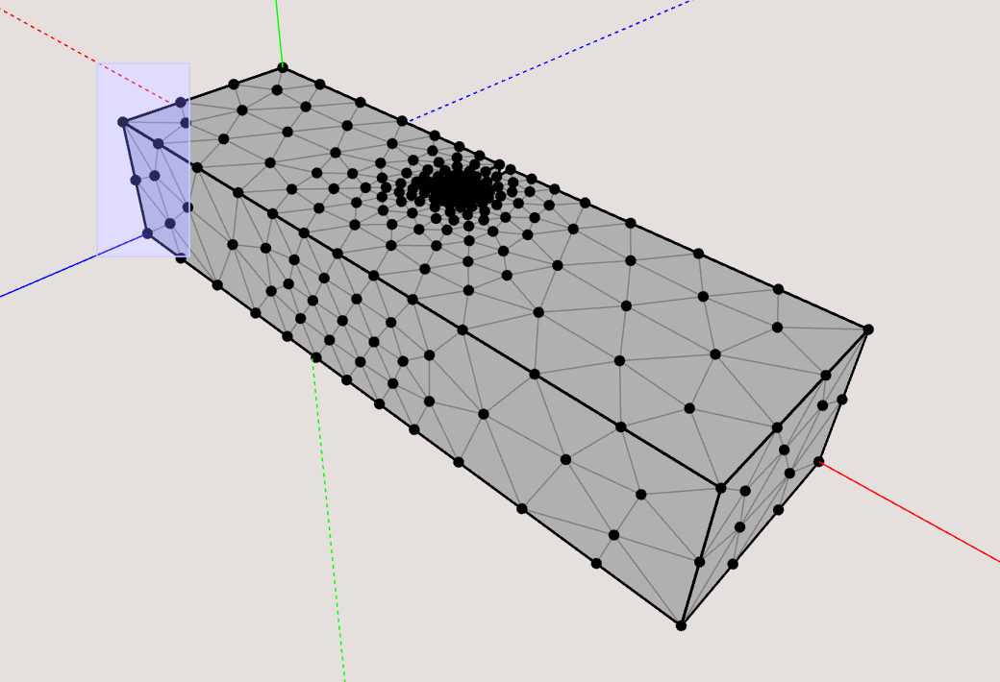

Only the entities on the visible surface of the mesh can be selected with the mouse. To select entities inside the volume of the mesh, use the [cutting area editor](#6-cutting-the-mesh-and-selecting-in-the-volume).

### 4.3 Adding to and removing from the selection

- Hold **Shift** to add the clicked or framed entities to the current selection.
- Hold **Ctrl** to remove them from the selection.
- Hold **Ctrl+Shift** and click once to toggle the entity under the cursor (select it if it isn't selected and unselect it if it is).

**Esc** clears the selection. The EDIT menu has further commands: *Select all*, *Unselect all*, *Invert selection*, *Select ... by property* and *Select ... inciding with selected faces* (see [EDIT](#edit)).

### 4.4 List of selected entities

*Tools → List of selected entities* (F3) lists the selected entities. Choose the type of entities in *Show list of selected*. With *Show complete info*, the list contains the full description of each entity (for faces, the number of nodes, the node IDs and the property), in the same form as in the SIFEL file. The text can be copied with the context menu (*Copy*, *Copy all*).

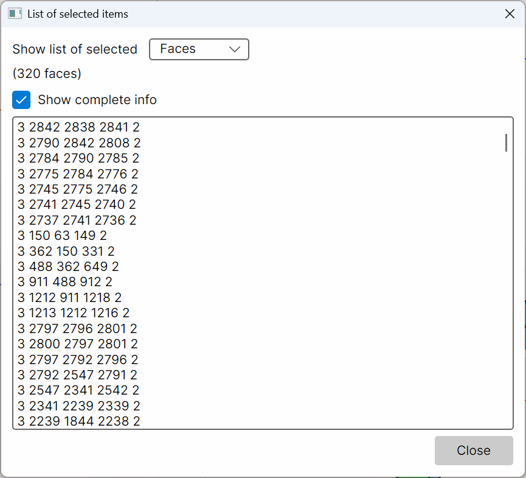

When nodes are listed, the links *Add property to nodes* and *Remove property from nodes* add a property to all selected nodes or remove it from them.

---

## 5. Properties

A property is an integer number assigned to a mesh entity. The solver uses the property numbers to assign boundary conditions, loads, materials and other attributes to the entities. Property 0 means no property.

### 5.1 Assigning a property

1. Select the entities with a selection tool (see [Selecting mesh entities](#4-selecting-mesh-entities)).
2. Choose *Edit → Set property of selected entities*, click the tool bar button, or press **Enter**.
3. Enter the property number and confirm with *OK*. The allowed values are integers from −2147483648 to 2147483647.

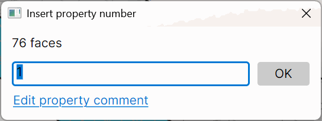

The dialog shows a description of the selected entities. The link *Edit property comment* sets a text description of the property (see [Property descriptions](#81-mesh-information)).

**Elements, faces, edges and beams** have one property. A new property replaces the previous one.

**Nodes** can have any number of properties. A new property is added to the list of properties of the node (if the node doesn't have it already). The properties of a node also carry the type of the entity they come from, shown in the status bar and in the list of selected entities as a prefix:

| Prefix | Entity type | Number in the SIFEL file |
|---|---|---|
| V | Vertex | 1 |
| E | Edge | 2 |
| S | Surface | 3 |
| R | Region | 4 |
| P | Patch | 5 |
| Sh | Shell | 6 |

A property assigned directly to selected nodes has the type *Vertex* (V). A node selected and described in the status bar may look like this: `Node 2803 | Position: [0; 1; 3] | Properties: S:1`. The properties of nodes can be added and removed in the [list of selected entities](#44-list-of-selected-entities).

### 5.2 Selecting by property

*Edit → Select ... by property* (F6) selects all entities with the given property. The type of the entities depends on the current selection tool. Check *add to selection* to keep the current selection (Shift+F6 opens the dialog with the box checked).

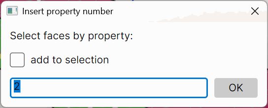

### 5.3 Selecting in the volume and assigning properties to elements

Elements inside the mesh can't be clicked. To give a property to elements in a part of the volume, select them with the [cutting area editor](#6-cutting-the-mesh-and-selecting-in-the-volume) (action *Select elements*) and then assign the property with Enter.

### 5.4 Property colors

*View → Property colors*, the tool bar drop-down button, or the keys **1** to **5** color the entities by their properties: 1 elements, 2 nodes, 3 faces, 4 edges, 5 beams. The colors of several entity types can be combined, except elements and faces. The node colors show the property added last; the saved file contains all properties of the node.

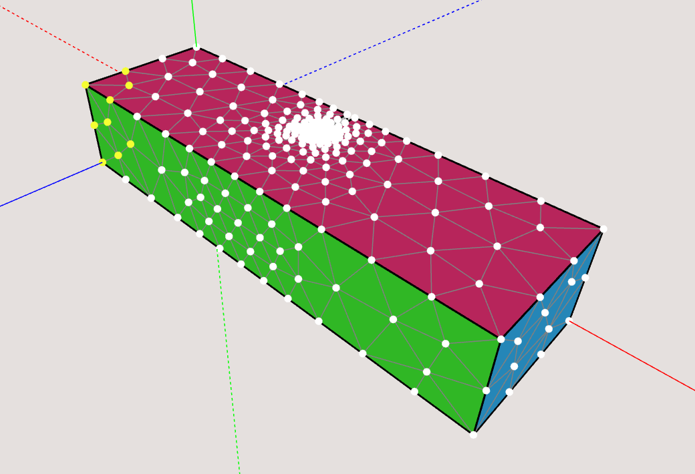

*Configure property colors* shows the color of each property of the mesh. Click a color to change it; *Reset to Defaults* restores the generated colors. The colors are generated so that the neighboring numbers are well distinguishable.

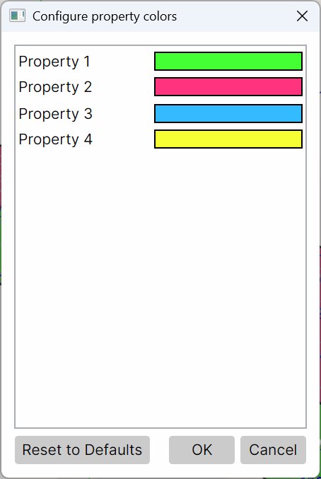

---

## 6. Cutting the mesh and selecting in the volume

*Tools → Cut / Select area* (F8) opens the **cutting area editor**. It defines a region of the mesh either by cutting planes or by an algebraic expression, and then performs an action with the entities in the region:

- **Cut** – hides the elements in the region, so that you can see inside the mesh,
- **Select elements**, **Select nodes**, **Select faces**, **Select edges**, **Select beams** – selects the entities of the given type in the region, including the entities inside the volume.

The button at the bottom right performs the action (*Cut* or *Select*). With **Full entity match** checked, an entity belongs to the region only when all its nodes lie in it; otherwise one node in the region is enough. **Restore mesh** shows all cut-off elements again. The editor stays open while you work with the mesh.

### 6.1 Cutting planes

1. Click **Create new cut plane**. MeshEditor switches to the mode of picking plane definition points.
2. Click three nodes on the surface of the mesh that lie in the cutting plane. After the third node, the plane is created. Alternatively, click two nodes – the first one lies in the plane and the direction from the first to the second one is the normal vector of the plane – and click *Create new cut plane* again.

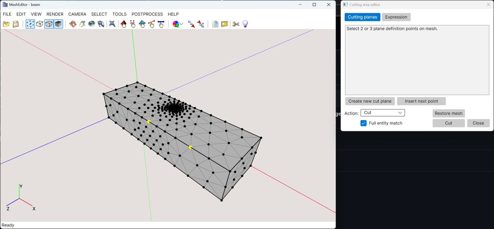

If you need to rotate or move the mesh between picking the points, choose a camera tool, move the camera, and then click **Insert next point** to continue picking. *Esc* removes the picked points.

The orientation of the plane is given by the order of the points and is indicated by the color of the plane: the two sides of the plane have different colors. Where you see red, the part of the mesh behind the plane will be cut off and the part in front of the plane will be kept; green means the opposite. **Invert selected planes** reverses the orientation, **Delete selected planes** removes the planes selected in the list. The list shows the equation of each plane.

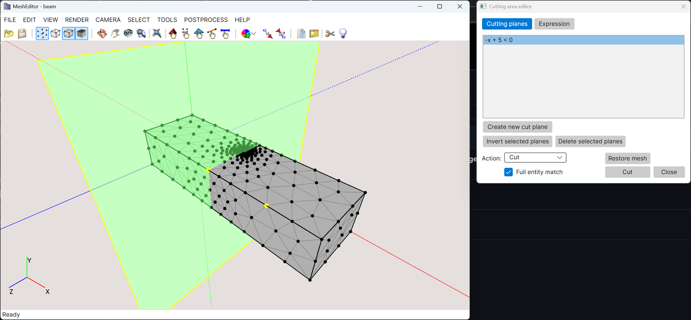

You can define any number of planes. When there are more of them, choose the **Cut type**: *Intersection* or *Union* of the half-spaces given by the planes. Then click **Cut** (or *Select*).

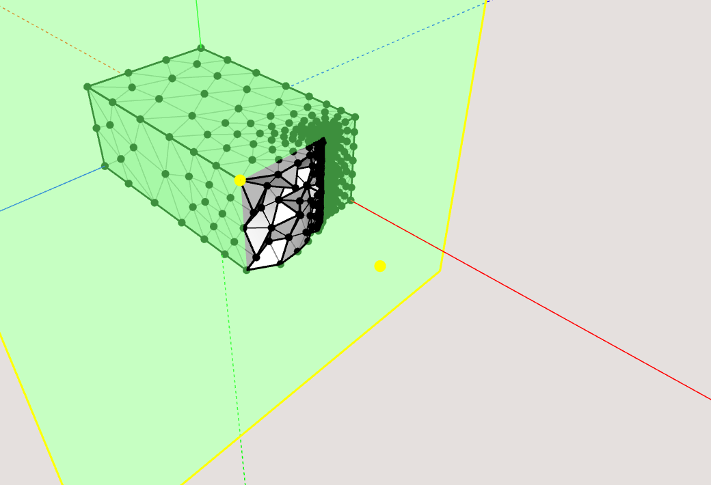

### 6.2 Expression

On the **Expression** tab, the region is given by a condition with the variables `x`, `y` and `z`. The coordinates of the nodes of each entity are substituted into the expression; the entity belongs to the region when the condition holds (for all nodes with *Full entity match*, for at least one node otherwise). The expression must be a condition, so it has to contain a relational operator, for example:

```
x < 5
x >= 0.0 and y >= 0.0
pow(x - 5, 2) + pow(z - 1.5, 2) < 1
```

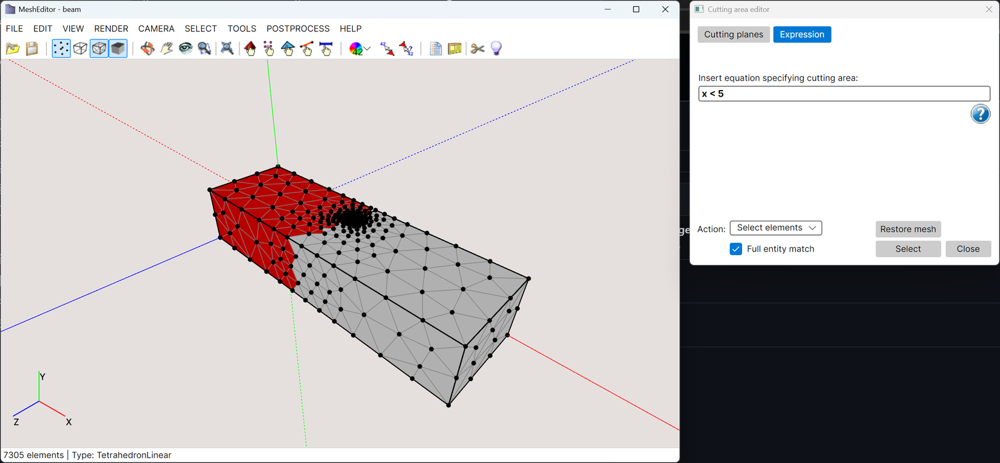

The help button next to the text box lists the available operators and functions:

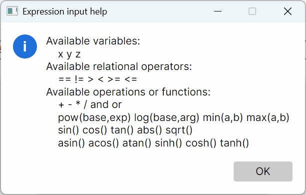

---

## 7. Showing and hiding elements

*Tools → Show / Hide elements* (F9) shows only some of the elements, by their property or by their type. Check the properties (or element types) of the elements you want to see and click **Apply**. *Check All* checks all items, *Check Selected* checks the items selected in the list. The hidden elements are shown again with *Tools → Restore mesh* (F10).

| Property numbers | Element types |
|---|---|
| 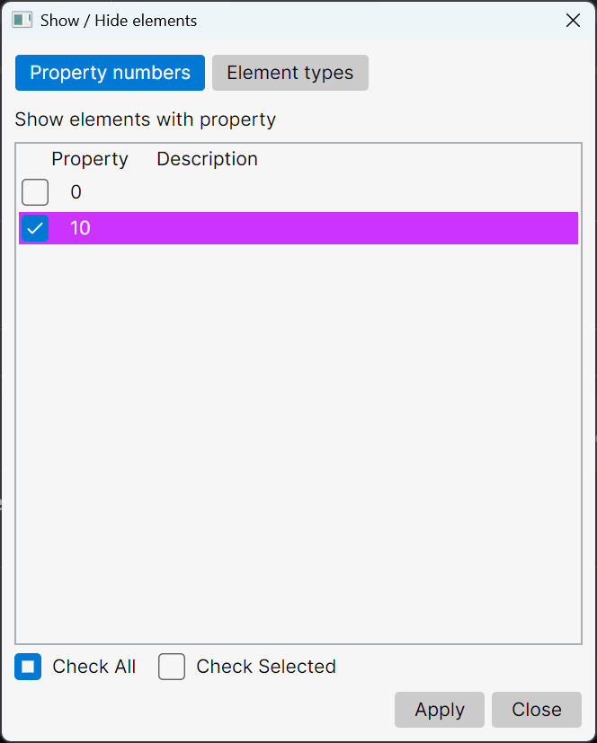 | 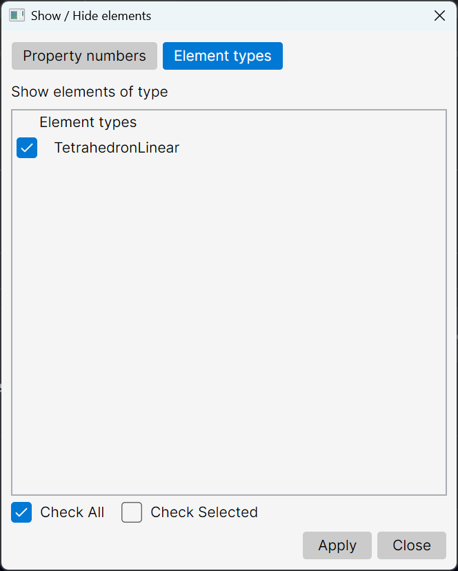 |

For example, after the elements in one half of the beam were given property 10 (see [Selecting in the volume](#53-selecting-in-the-volume-and-assigning-properties-to-elements)), unchecking property 0 leaves only these elements visible:

| Element property colors | Only property 10 shown |
|---|---|
| 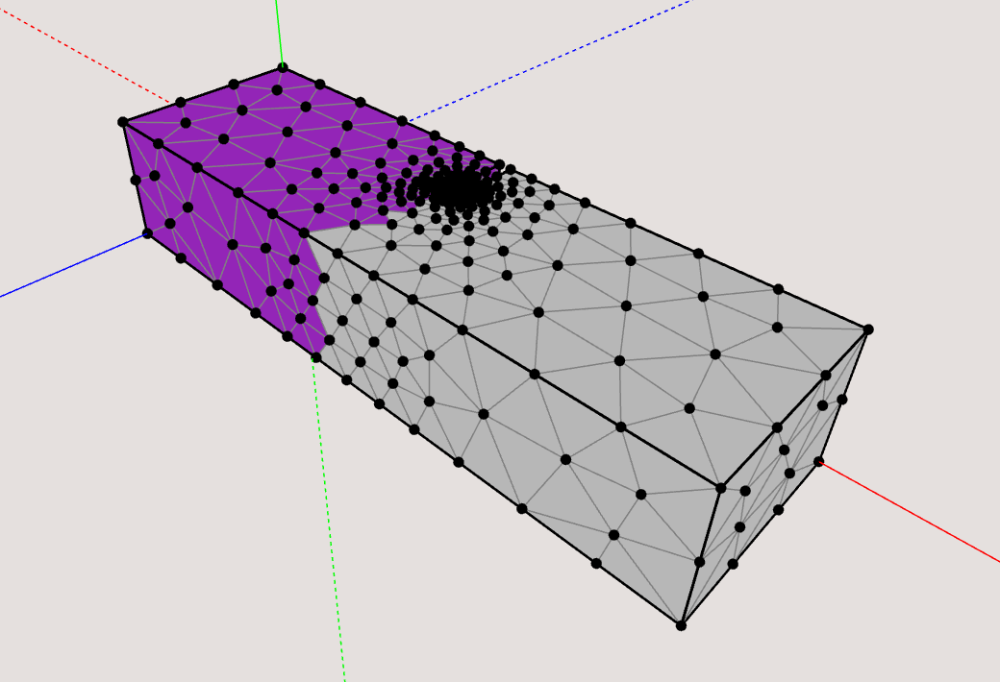 | 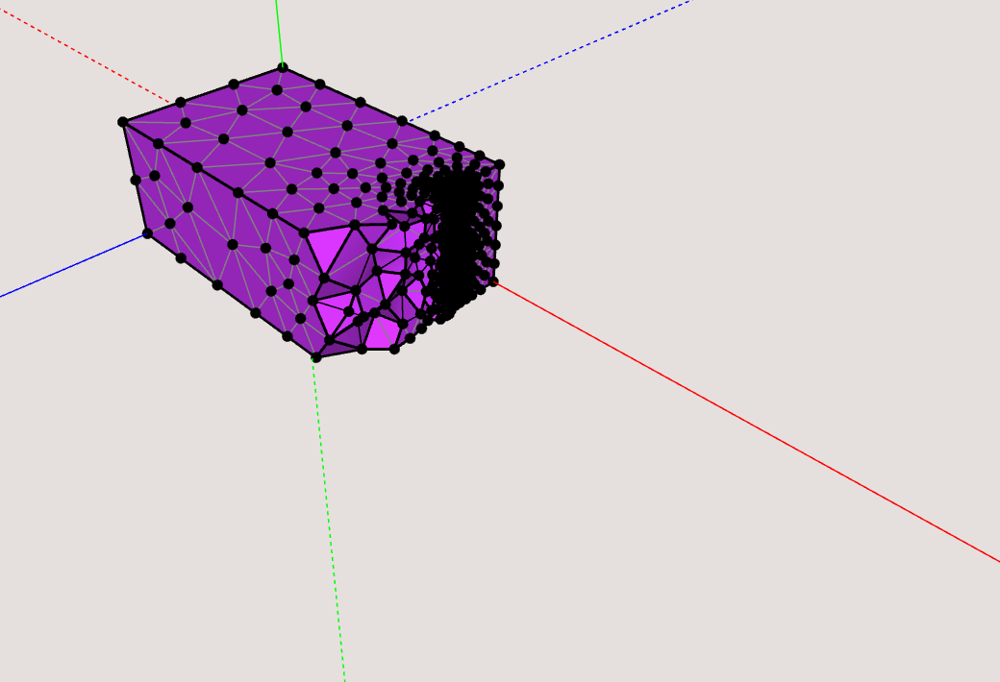 |

In the postprocessor, the dialog has a third tab, **Value limit** (see [Showing elements by value](#108-showing-elements-by-value)).

Hidden elements are not deleted. When you save a mesh with hidden elements, MeshEditor asks whether to save only the visible elements or the whole mesh.

---

## 8. Mesh information and edge angle limits

### 8.1 Mesh information

*Tools → Mesh info* (F4) has three tabs.

**Basic info** shows the number of nodes, elements (and beams), and the number of faces and edges on the surface of the mesh.

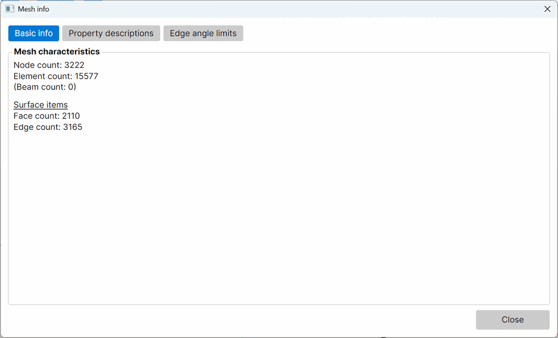

**Property descriptions** lists all properties used in the mesh with the type of entity they belong to, the preprocessor commands and a comment. **Edit comment** sets a text description of the selected property. The comments are saved in the SIFEL file (as `# Property <number>: <comment>` lines).

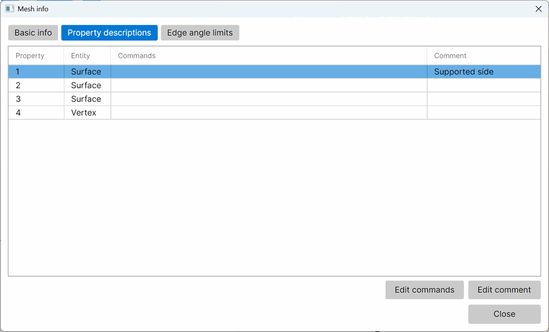

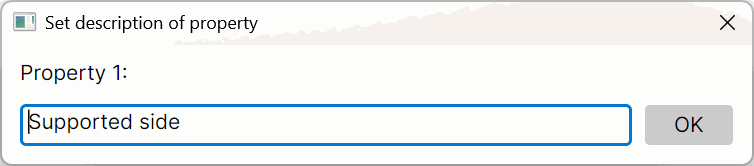

**Edit commands** opens the preprocessor commands of the selected property. A command describes what the property means for the SIFEL preprocessor: choose its *Type* (for example `bocon` for a boundary condition of nodes, `el_mat` for an element material, `surf_load` for a surface load), and fill in the values of the variables of the *Command pattern*. *Result text* shows the resulting command. A property can have several commands (*Add command*, *Remove command*). When the mesh is saved in the SIFEL format, the commands are written into a separate file with the extension `.prop` next to the mesh file, and the mesh file refers to it.

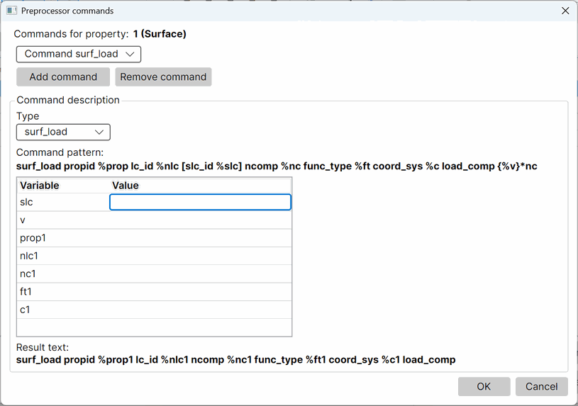

### 8.2 Edge angle limits

The edges of the mesh surface are divided into three categories by the angle between the two faces adjacent to the edge. The two limit angles between the categories determine:

- which edges are drawn as border (sharp) edges – the edges exceeding the first limit,
- how far the selection by double and triple clicks extends (see [Selecting by clicking](#41-selecting-by-clicking)).

The default limits (10° and 30°, see [Settings](#11-settings)) suit most meshes. You can change them for the current mesh on the **Edge angle limits** tab of *Mesh info*. The histogram shows how many edges of the mesh have each angle (from 0° to 180°); the dashed lines show the current limits. In the example, the box-shaped mesh has edges with 0° (flat surface) and 90° (box corners) only. Click **Apply** to use the new limits.

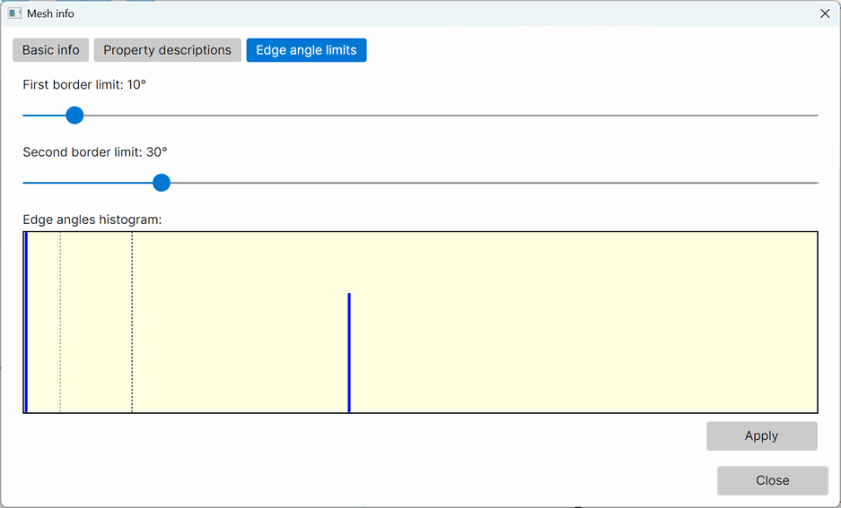

---

## 9. Other tools

### 9.1 Saving the mesh

*File → Save As* saves the mesh of the active view. The format is chosen by the file extension: the SIFEL format (`.top` by default, the extension can be changed in Settings), the GiD mesh format (`.msh`) or the VTK simple legacy format (`.vtk`). When the mesh contains hidden elements, MeshEditor asks whether to save it without them (*Yes*) or the whole mesh (*No*).

The properties of nodes, elements, faces and edges, the property comments and the preprocessor commands are saved in the SIFEL format (see [File formats](#13-file-formats)).

### 9.2 Signaling nodes and elements

*View → Signal node(s)* (Ctrl+Alt+N) highlights the nodes with the given IDs; enter one or more IDs separated by commas or spaces. Lines pointing at the signaled nodes help to find them even when they are hidden behind the surface or out of the view. *View → Signal element* (Ctrl+Alt+E) highlights an element. Choose the (checked) menu item again to remove the highlight.

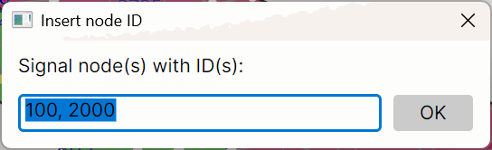

### 9.3 Screenshots

*Edit → Take screenshot* (Ctrl+Alt+S) saves an image of the active view. Choose **Whole scene**, or **Selection area** and then drag a rectangle over the part of the view you want to save. The image is saved as PNG, JPEG or BMP, according to the file extension.

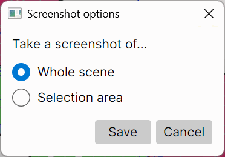

### 9.4 Internal state information

The *Pause* key shows the memory used by MeshEditor, the OpenGL version, the multisampling and the display scaling. It is useful when you report a problem.

---

## 10. Postprocessor

The postprocessor displays the results of a finite element analysis. The results are first imported into a **solution**: a folder with a `*.solution.json` file and the data of the solution in a compact form, which is fast to display. A solution consists of **layers**. The *master* layer contains the imported mesh and results; the filters (deformation, slice, iso-surface) create new layers derived from it.

### 10.1 Importing FEM results

*Postprocess → Import FEM results* creates a new solution from a mesh and result files.

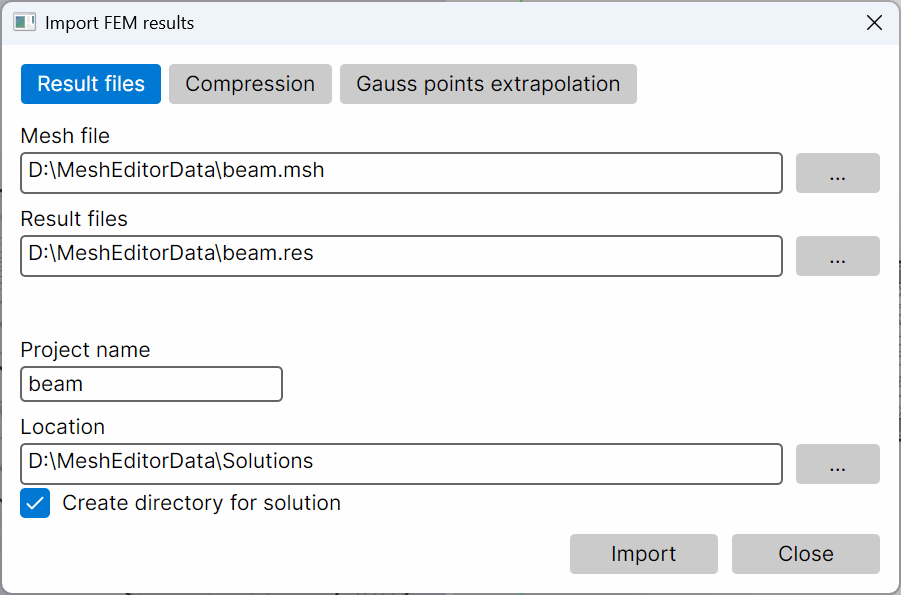

**Result files** tab:

- **Mesh file** – the mesh of the analysis: a GiD mesh (`.msh`), a VTK XML unstructured grid (`.vtu`), or a ParaView data collection (`.pvd`, a time series of `.vtu` files, each at its time step).
- **Result files** – the files with the results: GiD results (`.res`) or VTK XML unstructured grids (`.vtu`). Several files can be selected. For a ParaView collection, the results are in its `.vtu` files and this field is disabled.
- **Project name** – the name of the solution; it is derived from the name of the mesh file.
- **Location** – the folder in which the solution is created. With **Create directory for solution**, a subfolder named after the project is created in it.

**Compression** tab: the results can be compressed by singular value decomposition (SVD), which makes the solution smaller and faster to load at the price of a small error.

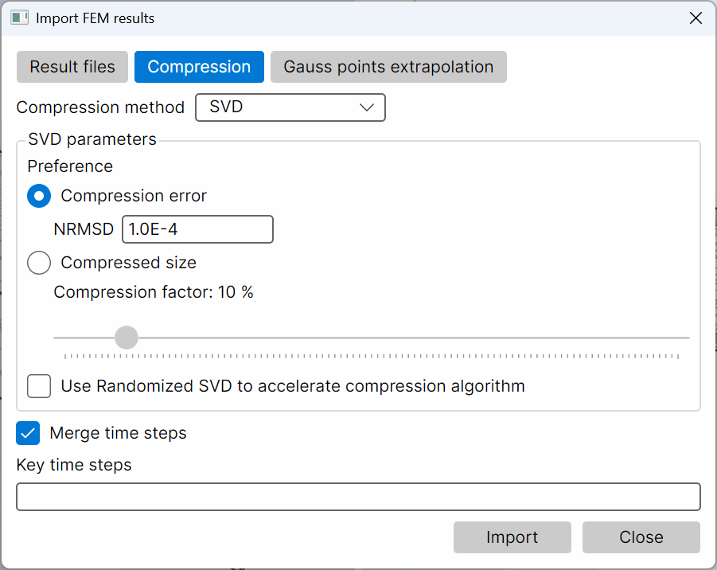

- **Compression method** – *None* or *SVD*.
- **Preference** – either the **Compression error**, given as the normalized root-mean-square deviation (**NRMSD**, for example `1.0E-4`), or the **Compressed size**, given by the **Compression factor** in percent.
- **Use Randomized SVD** – a faster, approximate algorithm for large data.
- **Merge time steps** – stores the data of consecutive time steps together, which allows the SVD to compress them together.
- **Key time steps** – the time steps (separated by spaces, for example `0.5 1 2.5`) at which a new group of merged time steps begins. Without key time steps, all time steps are merged into one group.

The parameters are checked before the import starts; an invalid NRMSD or key time step is reported.

**Gauss points extrapolation** tab: the strategy for the transfer of values given in the Gauss (integration) points to the nodes. The available strategy is *Nearest*.

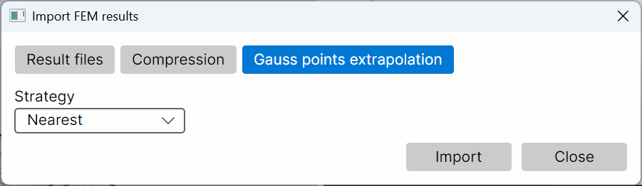

Click **Import**. The progress is shown in the status bar and in a progress window, where the import can be cancelled. After the import, the solution opens in the postprocessor.

### 10.2 Opening a solution

*Postprocess → Open solution* lists the solutions in the default solution folder, grouped by project. Select one and click *OK* (or double-click it). **Browse...** opens a solution file from any folder, **Delete** deletes the selected solution, and **Change default solution directory...** chooses the folder that is listed. A solution can also be opened with *File → Open* or given on the command line.

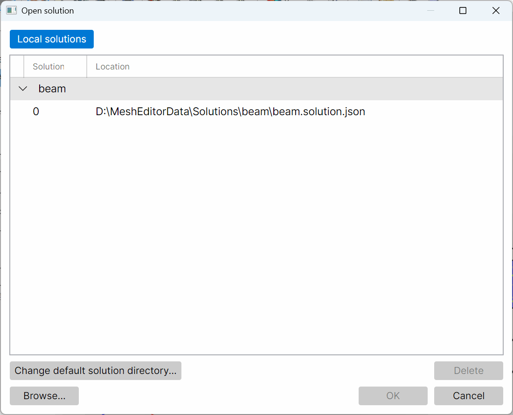

### 10.3 The postprocessor window


In the postprocessor, the main window has a left panel:

- **Layers** – the tree of the layers of the solution. The check box of a layer shows or hides it in the view; any number of layers can be displayed together. Clicking the name of a layer selects it; the data selection below belongs to the selected layer.
- **Data selection** – the time step and the data displayed on the selected layer (see below).

The width of the panel and the ratio of its two parts can be changed by dragging the splitters. The view on the right works as in the preprocessor: the camera tools, render modes, selection, cuts, split views and screenshots are all available. Each view of a split viewport can show different layers and data.

*Postprocess → Close solution* returns to the preprocessor.

### 10.4 Data selection

- **Time step** – the time step of the displayed data.
- **Scalars** – the field displayed as a color map, and its **component** (for example `X(1)`, `X(2)`, `X(3)` for a vector field or the components of a tensor). *[None]* shows the mesh without colors.
- **Vectors** – a vector field (with at most three components) displayed as arrows at the nodes.

The color map is described by the **legend** in the corner of the view with the name of the field, its component, the time step and the values of the color scale. The position of the legend can be changed in [Settings](#11-settings).

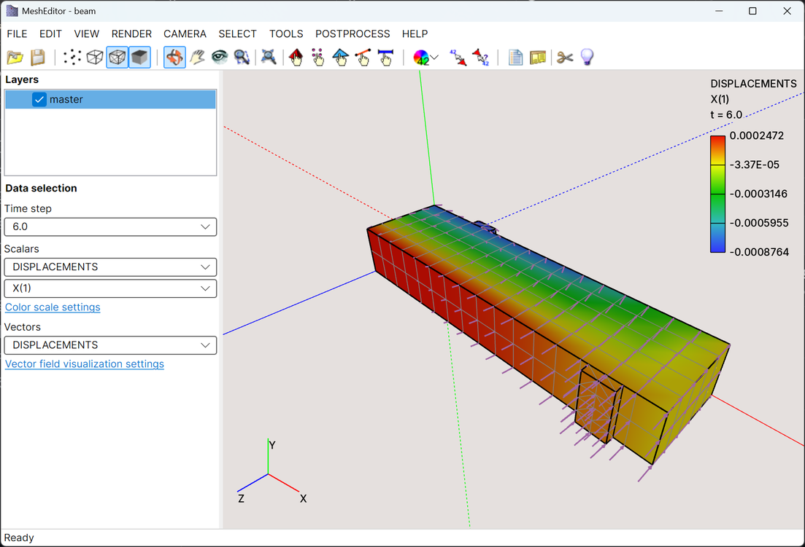

### 10.5 Color scale settings

The link **Color scale settings** below the scalar field opens the settings of the color scale:

- **Color scale type** – *LightSpectrum* (the default rainbow scale), *HeatGradient* (from blue to red), *Grayscale* (black to white) or *SeparatedByZero* (a scale with a fixed middle value 0).
- **Color scale control points** – the values and colors of the points of the scale. By default, the values follow the minimum and maximum of the displayed data. Check the box of a control point to fix its value and enter the value; click the color to change it.
- **Show iso-areas** – shows bands of constant color instead of a smooth color transition; **Number of sub-intervals** sets the number of bands between two control points.

*Apply* shows the changes without closing the dialog, *Cancel* returns the original settings.

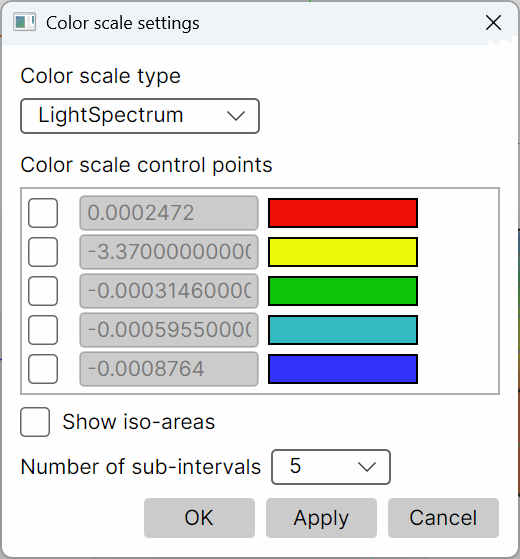

### 10.6 Vector field visualization settings

The link **Vector field visualization settings** below the vector field sets the **arrow length factor** (relative to the default length), **Fix arrow length** (all arrows have the same length and show only the direction), and **Invert vector arrows** (the arrows point in the opposite direction).

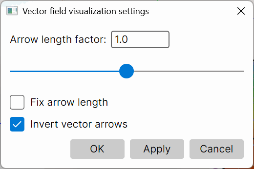

### 10.7 Signaling the maximum and minimum

*Postprocess → Signal data maximum* and *Signal data minimum* signal the nodes with the maximum or minimum value of the displayed scalar field. Like signaled nodes in the preprocessor, they are pointed at by dotted lines. *View → Signal node(s)* removes the highlight.


### 10.8 Showing elements by value

The **Value limit** tab of *Tools → Show / Hide elements* shows only the elements whose nodes have values of the displayed scalar field in the given range. Check **Maximum** and/or **Minimum** and enter the limits (the fields are filled in with the current extremes of the data). **Inverse** shows the elements outside the range instead. With **All nodes of element in range**, all nodes of an element must have values in the range; otherwise one node is enough. Click **Apply**.


### 10.9 Filters and layers

The context menu of a layer (right-click its name in the layer tree) has these items:

- **Apply filter...** – creates a new layer from the selected layer: *Deformation*, *Slice* or *Iso-surface*. The new layer is added under the selected layer in the tree and displayed.
- **Delete layer** – deletes the layer from the solution (the master layer can't be deleted).
- **Reload layer** – loads the layer again with the default data selection.


The new layers are stored in the solution, so they are available the next time the solution is opened.

#### Deformation

The deformation filter moves the nodes of the mesh by a displacement field, for each time step.

- **Field with displacements information** – the vector field of the displacements (a field whose name starts with *displacement* is preselected).
- **Scale** – the size of the largest displacement relative to the size of the mesh; for example 40 % means that the largest displacement is drawn as 40 % of the mesh dimension. Real displacements are usually very small, so they are magnified this way.
- **Deformation layer name** – the name of the new layer.


#### Slice

The slice filter creates a layer with the cross-section of the mesh by a plane; the data are interpolated onto the cross-section. The plane is defined by nodes picked on the mesh, as in the [cutting area editor](#61-cutting-planes): click **Define plane using two points** or **Define plane using three points** and click the nodes in the view. The dialog stays open while you pick the nodes. When the plane is defined, enter the **Slice layer name** and click *OK*.

#### Iso-surface

The iso-surface filter creates a layer with the surface on which a component of a field has the given value.

- **Field** and **Component** – the scalar quantity.
- **Value** – the value on the iso-surface.
- **Iso-surface layer name** – the name of the new layer.


The iso-surface can display other data than the one it was created from. In the next figure, the iso-surface *X(1) = −0.0002* shows the component *X(3)* of the displacements, and the master layer is displayed with border lines only.


### 10.10 Typical workflow

1. *Postprocess → Import FEM results*: choose the mesh and the result files, the location of the solution, optionally the compression, and click *Import*.
2. In the *Data selection*, choose the time step and the scalar field and its component. Adjust the color scale if needed.
3. Optionally display a vector field.
4. Create derived layers with the filters in the context menu of a layer, and display the layers you need with their check boxes.
5. Use the camera tools, cuts and *Show / Hide elements* to look inside the mesh, and save images with *Edit → Take screenshot*.
6. Next time, open the solution with *Postprocess → Open solution*.

---

## 11. Settings

*Tools → Settings* (F7) shows the application settings. They can be listed by category or alphabetically (*Categorized*, *A–Z*); the description of the selected setting is shown at the bottom. *Reset to Defaults* restores the default values. The settings are saved when MeshEditor closes.


| Category | Settings |
|---|---|
| Entity appearance | Smooth lines, Smooth points (antialiasing), Face lighting, Edge lighting, Node size, Ordinary edge width, Border edge width, Beam width (in pixels) |
| Entity colors | Face color, Node color, Ordinary edge color, First border edge color, Second border edge color, Beam color |
| Mesh appearance | Mesh shading model (smooth or flat), Default render mode, Default first border angle, Default second border angle (the default edge angle limits, see [Edge angle limits](#82-edge-angle-limits)) |
| Selection colors | Selected element, face, edge, node and beam colors, the color of a face selected together with its element, Selected element numbers color |
| Other colors | Background of the active and of the inactive view, Node numbers color, Element numbers color |
| Postprocessing | Color scale legend position, Vector arrows color |
| Other | SIFEL file format extension (`.top` by default), OpenGL version (read only, the version supported by the graphics card) |

---

## 12. Keyboard and mouse reference

### Mouse

| Action | Effect |
|---|---|
| Left button | the action of the current editor mode (rotate, pan, look around, zoom, select) |
| Left button held on the mesh | the coordinates of the point under the cursor in the status bar |
| Wheel | zoom in / out towards the cursor |
| Middle button click | zoom to fit |
| Right button | context menu |
| Shift / Ctrl with a camera tool | temporary switch to another camera tool (see [Camera manipulation](#32-camera-manipulation)) |
| Shift / Ctrl / Ctrl+Shift with a selection tool | add to / remove from / toggle in the selection |

### Keys in the viewport

| Key | Command |
|---|---|
| O, P, L, Z | Orbit, Pan, Look around, Zoom window |
| E, N, F, G, B | Select elements, nodes, faces, edges, beams |
| 1, 2, 3, 4, 5 | Property colors of elements, nodes, faces, edges, beams on/off |
| 7, 8, 9, 0 | Face lighting, line smoothing, point smoothing, edge lighting on/off |
| M | next render mode |
| R | reset the camera |
| Arrow keys | move the camera forward, back, left, right |
| Enter | set property of the selected entities |
| Esc | clear the selection and the picked plane definition points |
| Delete | hide the selected elements |
| Pause | internal state information |

### Menu shortcuts

| Key | Command |
|---|---|
| Ctrl+O | Open |
| Ctrl+S | Save As |
| Ctrl+A | Select all |
| Ctrl+Alt+S | Take screenshot |
| Ctrl+Alt+N | Signal node(s) |
| Ctrl+Alt+E | Signal element |
| F1 | User guide |
| F3 | List of selected entities |
| F4 | Mesh info |
| F5 | Refresh scene |
| F6 / Shift+F6 | Select entities by property (/ add to selection) |
| F7 | Settings |
| F8 | Cut / Select area |
| F9 | Show / Hide elements |
| F10 | Restore mesh |

The menus can also be opened with Alt and the underlined letter.

---

## 13. File formats

### 13.1 Supported formats

| Format | Extension | Open | Save | Import of results |
|---|---|---|---|---|
| SIFEL mesh format | `.top` (configurable) | yes | yes | |
| GiD mesh | `.msh` | yes | yes | mesh |
| GiD results | `.res` | | | results |
| VTK XML unstructured grid | `.vtu` | yes | | mesh and results |
| ParaView data collection | `.pvd` | | | mesh and results (time series) |
| VTK simple legacy format | `.vtk` | | yes | |
| Wavefront OBJ | `.obj` | yes | | |
| PLY | `.ply` | yes | | |
| Base64 JSON mesh | `.mesh.json` | yes | | |
| MeshEditor solution | `.solution.json` | yes (postprocessor) | | |

### 13.2 Element types

The element types and their numbers in the SIFEL format:

| Number | Element | Nodes | Edges | Faces |
|---|---|---|---|---|
| 1 | line (beam), linear | 2 | 1 | 0 |
| 2 | line (beam), quadratic (with a mid-side node) | 3 | 1 | 0 |
| 3 | triangle, linear | 3 | 3 | 1 |
| 4 | triangle, quadratic (with mid-side nodes) | 6 | 3 | 1 |
| 5 | quadrilateral, linear | 4 | 4 | 1 |
| 6 | quadrilateral, quadratic | 8 | 4 | 1 |
| 7 | tetrahedron, linear | 4 | 6 | 4 |
| 8 | tetrahedron, quadratic | 10 | 6 | 4 |
| 9 | square pyramid, linear | 5 | 8 | 5 |
| 10 | square pyramid, quadratic | 13 | 8 | 5 |
| 11 | triangular prism (wedge), linear | 6 | 9 | 5 |
| 12 | triangular prism (wedge), quadratic | 15 | 9 | 5 |
| 13 | hexahedron (brick), linear | 8 | 12 | 6 |
| 14 | hexahedron (brick), quadratic | 20 | 12 | 6 |

### 13.3 The SIFEL mesh format

The SIFEL format is a text format. Lines starting with `#` are comments. Numbers use a decimal point. The file contains:

1. Optional **property comments**: lines `# Property <number>: <comment>`.
2. Optionally the reference to the **preprocessor commands file**: `# PropertyDescriptionFile: <file name>`.
3. The **number of nodes**, followed by one line per node:

   `<node ID> <x> <y> <z> <number of properties np> {<entity type> <property>} × np`

   The entity type is a number from the table in [Assigning a property](#51-assigning-a-property) (1 vertex, 2 edge, 3 surface, 4 region, 5 patch, 6 shell).
4. The **number of elements**, followed by one line per element:

   `<element ID> <element type> <node IDs> <element property> [<edge properties>] [<face properties>]`

   The number of node IDs is given by the element type (see [Element types](#132-element-types)). The optional edge properties (one per edge of the element) and face properties (one per face) are written in the order of the edges and faces of the element type; 0 means no property.
5. Optionally, lists of **faces** and **edges** with properties:

   ```
   faces <count>
   <number of nodes> <node IDs> <property>
   ...
   edges <count>
   <first node ID> <second node ID> <property>
   ...
   ```

Lines between the elements and the `faces` / `edges` lists that are not recognized are skipped.

An example of a small 2D mesh of four quadrilaterals with node, element and edge properties:

```
# Property 4: fixed support
# Property 12: plate

9
1 0.0 0.0 0.0 5  1 1  2 7  2 10  3 11  5 12
2 1.0 0.0 0.0 4  1 0  2 7  3 11  5 12
3 2.0 0.0 0.0 5  1 2  2 7  2 8  3 11  5 12
4 0.0 1.0 0.0 4  1 0  2 10  3 11  5 12
5 1.0 1.0 0.0 3  1 0  3 11  5 12
6 2.0 1.0 0.0 4  1 0  2 8  3 11  5 12
7 0.0 2.0 0.0 5  1 4  2 9  2 10  3 11  5 12
8 1.0 2.0 0.0 4  1 0  2 9  3 11  5 12
9 2.0 2.0 0.0 5  1 3  2 8  2 9  3 11  5 12

4
1 5  1 2 5 4  12  7 0 0 10
2 5  2 3 6 5  12  7 8 0 0
3 5  4 5 8 7  12  0 0 9 10
4 5  5 6 9 8  12  0 8 9 0
```

When the mesh has preprocessor commands, MeshEditor saves them into a file with the extension `.prop` next to the mesh file. The commands file is divided into sections (`begsec_<name>` … `endsec_<name>`) for node and element properties of vertices, edges, surfaces and regions, as expected by the SIFEL preprocessor.
